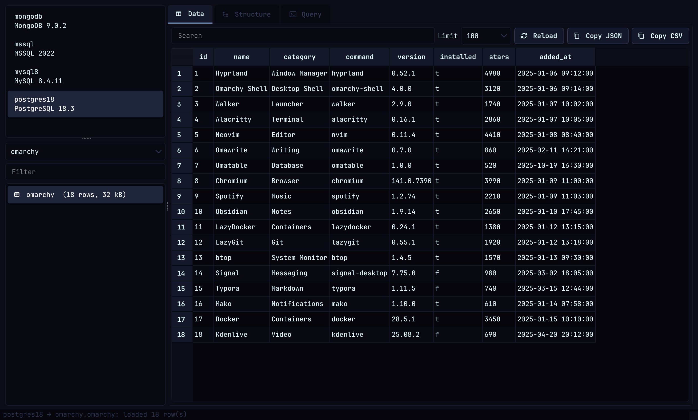
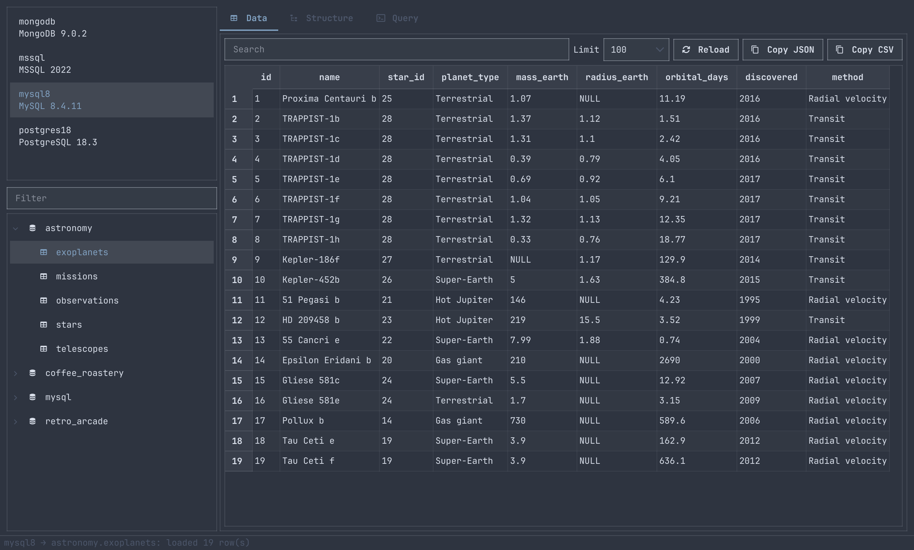
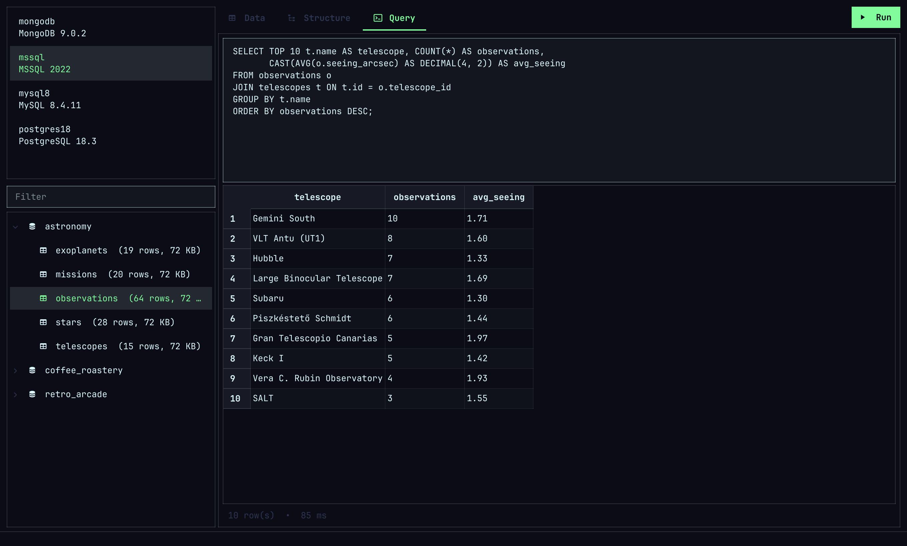
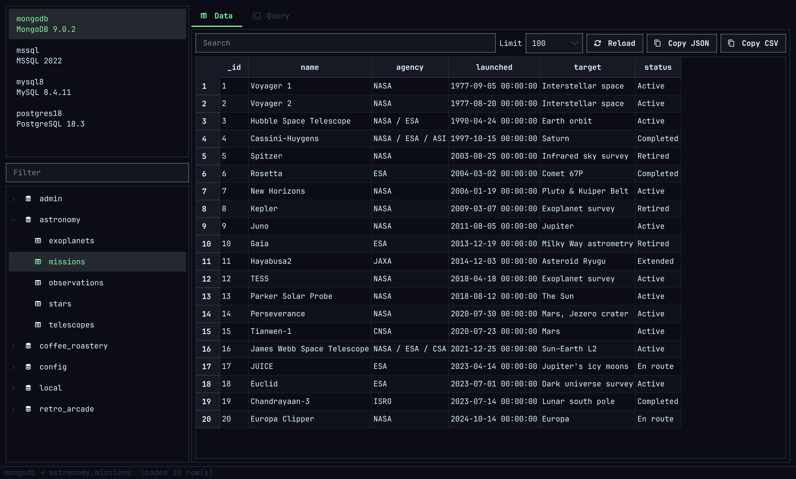
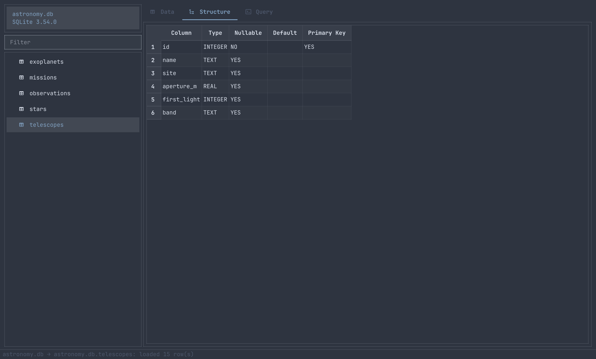

# Omatable

A database browser for [Omarchy](https://omarchy.org). It finds every database container in Docker and opens SQLite files. It runs only while its window is open, with no bar widget and no background process, and you can open as many windows as you like.


## Supported databases

| Engine | Source | Browse | Query | Terminal |
|---|---|---|---|---|
| PostgreSQL | Docker container | databases, tables, views | SQL | `psql` |
| MySQL / MariaDB | Docker container | databases, tables | SQL | `mysql` / `mariadb` |
| Microsoft SQL Server | Docker container | databases, tables | T-SQL | `sqlcmd` |
| MongoDB | Docker container | databases, collections | `mongosh` JavaScript | `mongosh` |
| Redis | Docker container | logical DBs 0–5, keys with type and TTL | `redis-cli` commands | `redis-cli` |
| SQLite | `.db` / `.sqlite` / `.sqlite3` file | tables, views | SQL | `sqlite3` |

Containers are discovered automatically, whether they come from `docker compose`, a plain `docker run`, or `omarchy-install-docker-dbs`. Credentials, ports and default databases are read from the container's environment, and every query runs through `docker exec`, so no database clients are needed on the host. SQLite files are read directly with Python's built-in `sqlite3` module.

## Using it

**Sidebar.** Containers are listed at the top, each showing only its name and engine version; stopped containers are dimmed. Below them are the database picker, a filter and the tables, keys or collections of the selected database. Omatable opens on your own database rather than a system one (`postgres`, `admin`, `master`).

**Right-click a container** for:

- Start / Stop Container
- Copy DSN / URL
- Terminal Shell
- Rescan Docker
- Install DB (runs `omarchy-install-docker-dbs`)

**Tabs.**

- **Data:** the first rows of the selected table. Change the limit (50 to 1000), search inside the loaded rows, sort by any column, double-click a cell to inspect and copy it (JSON is pretty-printed), and copy the rows as JSON or CSV.
- **Structure:** columns with type, nullability and default. SQLite also shows the primary key. The tab is hidden for MongoDB and Redis, which have no fixed columns.
- **Query:** write a query and press **Run** (or `Ctrl+Enter` / `F5`). Results appear in the grid. The line below shows only the row count and the time taken, or the error message if the query failed. The editor starts empty, and each container keeps its own query when you switch between them.

**Confirmation before changes.** Before running anything that can create, change or delete data, Omatable asks first and shows the full query again. **Cancel** is the default button. What triggers it:

- **SQL:** `INSERT`, `UPDATE`, `DELETE`, `CREATE`, `ALTER`, `DROP`, `TRUNCATE`, `MERGE`, `REPLACE`, `GRANT`, `SELECT … INTO`, `EXEC` and similar. Keywords inside strings or comments are ignored.
- **Redis:** any command that is not a read, such as `SET`, `DEL` or `FLUSHALL`.
- **MongoDB:** `insert*`, `update*`, `delete*`, `drop*`, `replace*` and `bulkWrite`, plus `$out` / `$merge` aggregations.

Browsing tables never asks.

**SQLite files.** When you open a file, the sidebar shows just the file name and SQLite version on top, with no database picker, and its tables and views below. Right-click the name to copy its path, reload it, or open it in `sqlite3`.

**Status bar.** While something loads, a spinner and a short message appear in the bottom-left corner; nothing else moves.

**Look.** Omatable follows the active Omarchy theme colors and font, with thin scrollbars and smooth, per-pixel scrolling.

## Screenshots

| | |
|---|---|
|  |  |
|  |  |
|  | |

## Requirements

- `python` 3.10+ and `python-pyqt6`
- `docker`, for container databases. The current user needs Docker access, or passwordless `sudo docker`.

## Install

### As an Omarchy plugin

```bash
omarchy plugin add https://github.com/gothe92/omatable --enable
```

The plugin is a lazy `overlay`: nothing is loaded until it is summoned, and each summon opens a new Omatable window. To open it with `SUPER + ALT + SHIFT + D`, add this to `~/.config/hypr/bindings.lua`:

```lua
o.bind("SUPER + ALT + SHIFT + D", "Omatable", "omarchy-shell shell summon andras.omatable")
```

To open a specific SQLite file through the plugin:

```bash
omarchy-shell shell summon andras.omatable '{"path": "/path/to/file.sqlite"}'
```

### As a desktop app

```bash
./install.sh
```

This installs:

- `~/.local/bin/omatable`
- the launcher entry (`SUPER + SPACE` → **Omatable**)
- the icon

It also makes Omatable the default app for SQLite files, so double-clicking a `.db` / `.sqlite` file opens it.

```bash
omatable                    # browse Docker databases
omatable my-container       # start with a specific container selected
omatable path/to/app.db     # open a SQLite file
```

## Uninstall

```bash
./install.sh --uninstall
omarchy plugin remove andras.omatable
```

Uninstalling removes only the files Omatable installed and its own SQLite default-app entries. Your databases, containers and files are never touched.

## Keyboard navigation

You can do everything without the mouse:

1. **Containers** have focus when Omatable opens. Type a few letters to jump to a container, then press `Enter` (or `→`).
2. **Tables:** start typing to filter them; the filter fills in as you type. Use `↑` / `↓` to move and `Enter` (or `→`) to open the table in the Data tab.
3. **Data grid:** `Esc` goes back to the tables. In the tables, `Esc` clears the filter first, and pressing it again goes back to the containers (`←` also works).

Moving through tables with the arrow keys loads each one after a short pause, so holding a key down doesn't fire a query for every row.

## Keyboard shortcuts

| Shortcut | Action |
|---|---|
| `Ctrl+Enter` / `F5` | Run the query |
| `Ctrl+R` | Rescan Docker (or reload the SQLite file) |
| `Ctrl+F` | Focus the table / key filter |
| `/` | Search inside loaded rows |
| `Ctrl+Shift+C` | Copy the connection URL |
| `Ctrl+T` | Open the database CLI in a terminal |
| `Alt+1` / `Alt+2` / `Alt+3` | Data / Structure / Query tab |
| `Ctrl+Q` | Close the window |
| `Super+Alt+Shift+D` | Open a new Omatable window (suggested Hyprland binding, see above) |

## License

[MIT](LICENSE)
